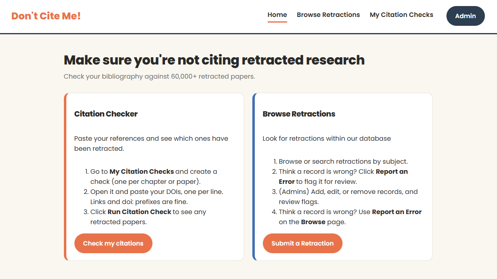

# Don't Cite Me!

Check your bibliography against a database of 60,000+ retracted academic papers, browse retractions by subject, and report records you believe are wrong.

**Live site:** [https://dontciteme.onrender.com/](https://dontciteme.onrender.com/)
_(Hosted on a free tier, so the first load after a period of inactivity can take up to a minute while the server wakes up.)_



## Authors

- **Tor Ekstrom**: Citation Checker (`checks` collection)
- **Thejaswini Srinivasan Manjula**: Retraction Manager (`retractions` and `flags` collections)

## Class

CS 5610 Web Development, Northeastern University, taught by Prof. John Alexis Guerra Gomez.
[CLASS LINK](https://johnguerra.co/classes/webDevelopment_online_fall_2026/)

## Project Objective

Research is hard enough without having to confirm that your citations aren't based on retracted papers. Looking up each reference by hand is tedious, and often unrealistic on a deadline. **Don't Cite Me!** gives researchers a quick way to:

- check a whole reference list against known retractions at once,
- browse and search retraction records, and
- flag records they believe are incorrect, so an admin can review and correct them.

Retraction data comes from the _Global Academic Retractions (2000–2025)_ dataset on Kaggle, imported into MongoDB.

### User personas

- **Einju, a thesis writer**, wants to make sure she isn't citing retracted sources across a large, growing reference list.
- **Tony, a journal editor**, processes retractions and keeps the database up to date.
- **Eileen, a researcher**, needs a way to report a retraction record she believes is wrong.

## Features

### Citation Checker (Tor)

- Create named citation checks (for example, one per thesis chapter). Checks are tied to an anonymous browser ID, so each user only sees their own. No account is needed.
- Rename and delete checks.
- Add DOIs by pasting them one per line. DOIs are normalized automatically: whitespace is trimmed, case is lowered, and `https://doi.org/`, `https://dx.doi.org/`, and `doi:` prefixes are stripped. Duplicates are ignored.
- Remove individual DOIs.
- **Run a check** to see which DOIs match retracted papers, with the title, journal, retraction date, and retraction reasons for each match.

### Retraction Manager (Thejaswini)

- Browse and search retraction records by subject category, with pagination.
- Report an error on a record you believe is incorrect.
- Browsing retractions and reporting a record require no login.
- **Admin only** (password protected): add, edit, and delete retraction records, and review flagged records.
- New retraction records are assigned a unique record_id automatically, since the imported dataset enforces a unique index on that field.

## How to Use

1. Open **My Citation Checks** and create a check, such as "Chapter 2".
2. Click **Open** on the check, paste your DOIs (one per line) into the form, and click **Add DOIs**.
3. Click **Run Citation Check** to see any retracted papers in your list.
4. To explore the database, use **Browse Retractions**. If a record looks wrong, click **Report an Error**.
5. Admins can click **Admin** in the header and enter the admin password to add or edit retractions and review flags.

## Tech Stack

- **Frontend:** HTML5, CSS3, vanilla JavaScript (ES modules, client-side rendering)
- **Backend:** Node.js and Express 5 (ES modules)
- **Database:** MongoDB Atlas, using the native Node.js driver (no Mongoose)
- **Tooling:** ESLint and Prettier

## Project Structure

```
├── bin/www                 # Starts the HTTP server
├── app.js                  # Express app: middleware, API routes, error handling
├── db/
│   ├── connection.js       # Shared MongoDB connection
│   ├── retractionsDB.js    # Retractions queries
│   └── flagsDB.js          # Flags queries
├── middleware/
│   └── requireAdmin.js     # Checks the admin password header
├── routes/
│   ├── checks.js           # /api/checks
│   ├── retractions.js      # /api/retractions
│   └── flags.js            # /api/flags
└── public/                 # Static frontend (HTML, CSS, browser JS)
    ├── index.html, checks.html, check.html, search.html, article.html, ...
    ├── javascripts/
    └── stylesheets/
```

## API Overview

| Method | Endpoint                        | Description                              |
| ------ | ------------------------------- | ---------------------------------------- |
| GET    | `/api/checks`                   | List this browser's checks               |
| POST   | `/api/checks`                   | Create a check                           |
| GET    | `/api/checks/:id`               | Get one check                            |
| PATCH  | `/api/checks/:id`               | Rename a check                           |
| DELETE | `/api/checks/:id`               | Delete a check                           |
| POST   | `/api/checks/:id/dois`          | Add DOIs to a check                      |
| DELETE | `/api/checks/:id/dois`          | Remove a DOI from a check                |
| GET    | `/api/checks/:id/results`       | Find retractions matching a check's DOIs |
| GET    | `/api/retractions`              | Browse/search retractions                |
| GET    | `/api/retractions/:id`          | Get one retraction                       |
| POST   | `/api/retractions`              | Add a retraction (admin)                 |
| PUT    | `/api/retractions/:id`          | Edit a retraction (admin)                |
| DELETE | `/api/retractions/:id`          | Delete a retraction (admin)              |
| POST   | `/api/retractions/verify-admin` | Verify the admin password                |
| POST   | `/api/flags`                    | Flag a record as incorrect               |
| GET    | `/api/flags`                    | List flags (admin)                       |
| PUT    | `/api/flags/:id`                | Update a flag's status (admin)           |
| DELETE | `/api/flags/:id`                | Delete a flag (admin)                    |

Check routes require an `X-Browser-Id` header. Admin routes require an `X-Admin-Password` header.

## Running Locally

### Prerequisites

- [Node.js](https://nodejs.org/) 20.11 or newer (developed on Node 24)
- A MongoDB Atlas cluster (the free tier works), with your IP address allowed under **Network Access**

### Steps

1. **Clone the repository and install dependencies:**

   ```
   git clone https://github.com/tekstrom11/DONTCITEME.git
   cd DONTCITEME
   npm install
   ```

2. **Create a `.env` file** in the project root (see `.env.example`):

   ```
   MONGODB_URI=your-mongodb-connection-string
   ADMIN_PASSWORD=choose-an-admin-password
   ```

3. **Load the retraction data.** The app uses a database named `retractions` with these collections:
   - `retractions`: import the Kaggle _Global Academic Retractions (2000–2025)_ dataset, for example with MongoDB Compass (**Add Data → Import JSON or CSV file**) or `mongoimport`.
   - `checks` and `flags`: created automatically the first time they're used.

   For citation checks to match reliably, the `original_paper_doi` values should be lowercase. An index on that field keeps lookups fast:

   ```js
   db.retractions.updateMany({ original_paper_doi: { $type: "string" } }, [
     { $set: { original_paper_doi: { $toLower: "$original_paper_doi" } } },
   ]);
   db.retractions.createIndex({ original_paper_doi: 1 });
   ```

4. **Start the server:**

   ```
   npm start
   ```

   Then open [http://localhost:3000](http://localhost:3000).

### Other scripts

| Command            | What it does                                 |
| ------------------ | -------------------------------------------- |
| `npm run dev`      | Start with auto-restart on file changes      |
| `npm run lint`     | Check code with ESLint                       |
| `npm run lint:fix` | Fix lint issues automatically where possible |
| `npm run format`   | Format all files with Prettier               |

## License

[MIT](LICENSE)

## AI Use Disclosure

- **This README** was drafted by Claude (Anthropic) from the project's source code and design notes, then reviewed and edited by the authors.
- **Tor Ekstrom** used Claude as a tutoring/debugging while building the Citation Checker: for explanations of Express, MongoDB, and browser JavaScript concepts, generating examples, and for help reading error messages and reviewing code. Tor wrote the Citation Checker code.
- **Thejaswini Srinivasan Manjula:** Used Claude mainly for debugging (interpreting error messages and tracing bugs like MongoDB ObjectId conversion and a unique-index collision) and for understanding concepts (REST verbs, Express middleware, async/await) while building the Retraction Manager. Also used for documentation support.
